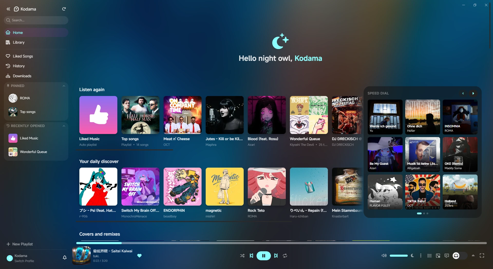

<div align="center">
  
</div>

<div align="center">
  <p>An unofficial desktop player for YouTube Music.</p>

  [](https://github.com/KiyoshiTheDevil/Kodama/releases/latest)
  [](https://github.com/KiyoshiTheDevil/Kodama/releases)
  [](https://github.com/KiyoshiTheDevil/Kodama)
  [](https://github.com/KiyoshiTheDevil/Kodama/releases/latest)
  [](https://tauri.app)
  [](https://crowdin.com/project/kiyoshi-music)
  [](LICENSE)

  <p><a href="https://kodama.kiyoshi.dev"><b>kodama.kiyoshi.dev</b></a> · <a href="https://kodama.kiyoshi.dev/store/">Store</a> · <a href="https://discord.gg/PzSsPF7KW">Discord</a></p>
</div>

<p align="center">
  
</p>

---

> AI notice: This app has been created with an LLM called **Claude Code**. If you're against the usage of LLMs or AI in any capacity, this app won't be for you. I hope you understand.

## Features

- **Synced lyrics** line, word and syllable by syllable, with translations and romaji, plus **Unison** community lyrics.
- **Listen together**: start a room, send the link, and your friends hear the same song at the same moment.
- A **visualizer**, **themes** and dynamic accent colours drawn from the cover.
- A **store** with themes, visualizer and equalizer presets and extensions, at [kodama.kiyoshi.dev/store](https://kodama.kiyoshi.dev/store/).
- **Crossfade**, a ten-band **equalizer** and a mini player.
- **Remote control** from your phone over your local network.
- **Overlay editor** for streaming. It is moving into its own app, [Ofuda](https://ofuda.kiyoshi.dev), which works with any music player.
- **Offline downloads**, Discord Rich Presence and Last.fm scrobbling.
- Accessibility options: reduce motion, mono audio, a readable accent and song announcements for screen readers.

> A Google account is not required to use the player, Premium isn't required either.
> Please be aware that some content might be inaccessible due to Premium restrictions.

## Download

Get the latest version from [**kodama.kiyoshi.dev**](https://kodama.kiyoshi.dev) or the [**Releases**](https://github.com/KiyoshiTheDevil/Kodama/releases/latest) page.

**Windows:** download and run the `*_x64-setup.exe` installer.

**macOS (Apple Silicon):** the build is **unsigned**, so install it with this command (it
downloads the latest release and avoids Gatekeeper's quarantine):

```bash
curl -fsSL https://raw.githubusercontent.com/KiyoshiTheDevil/Kodama/master/install.sh | bash
```

## Bugs and ideas

Please send bug reports and suggestions on the [Discord server](https://discord.gg/PzSsPF7KW). It's easier for me to keep track of them there than on GitHub, and you can chat about the project too. There's also a bug report button inside the app.

**I no longer actively check issues here on GitHub.**

## Translations

Kodama is translated by the community on [Crowdin](https://crowdin.com/project/kiyoshi-music). Every bit of help is welcome, and translators are credited in the app.

## For Developers

### Prerequisites

- [Node.js](https://nodejs.org/) v20+
- [Rust](https://rustup.rs/) (stable)
- [Python](https://www.python.org/) 3.10+

### Setup

```bash
# 1. Clone
git clone https://github.com/KiyoshiTheDevil/Kodama.git
cd Kodama

# 2. Frontend dependencies
npm install

# 3. Python backend dependencies
cd python-backend
pip install -r requirements.txt
cd ..
```

Signing in with your YouTube account happens inside the app.

### Run in development mode

```bash
npm run tauri dev
```

### Build

```bash
npm run tauri build
```

---

## Changelog

See [CHANGELOG.md](CHANGELOG.md) for a full version history.

## License

Kodama is licensed under the **[GNU Affero General Public License v3.0](LICENSE)** (AGPL-3.0).
You are free to use, study, modify and redistribute it, provided derivative works remain under
the same license and their source is made available.

## Disclaimer

Kodama is an **unofficial** client and is **not affiliated with or endorsed by YouTube or
Google**. It relies on the unofficial YouTube Music API and is provided for personal use, as-is
and without warranty. Use at your own risk.
